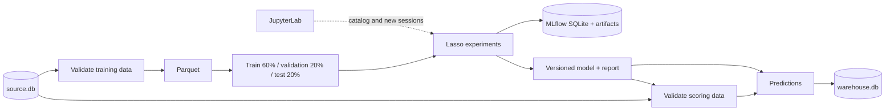
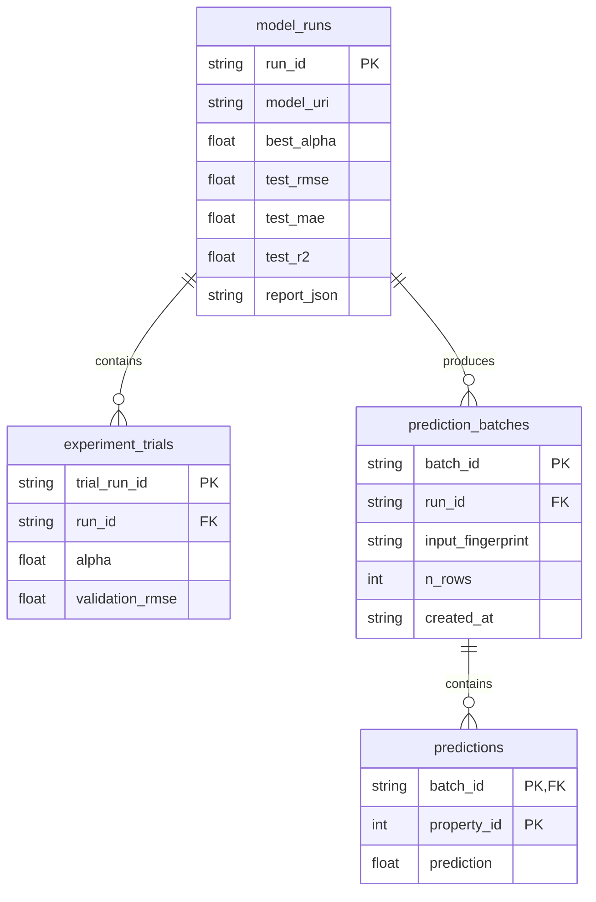

# Project architecture

## Component boundaries

Kedro owns the dependency graph, configuration, data catalog, and node execution. JupyterLab explores and runs the same code. MLflow tracks experiments and stores a model that can be restored outside Kedro. Kedro-Viz only visualises the pipeline; no processing step depends on its UI.



| Path | Responsibility |
| --- | --- |
| `src/kedro_lasso/domain.py` | Data contracts, sklearn pipeline construction, and metrics |
| `training.py` | Splits, experiments, model selection, and MLflow logging |
| `scoring.py` | Batch inference and prediction-batch construction |
| `datasets.py` | SQL output adapter, schema, and transaction |
| `pipelines/` | Node declarations and their inputs and outputs |
| `pipeline_registry.py` | `prepare`, `training`, `scoring`, and default pipeline composition |
| `commands.py` | Local seed, inspection, service, and supervisor operations |
| `conf/base/` | Shared parameters, catalog, and demo connections |
| `conf/local/` | Git-ignored local overrides |
| `conf/quick/` | Alternate experiment parameters |
| `notebooks/` | Exploratory client for the project |
| `tests/` | Contracts, disjoint splits, persistence, and end-to-end flow |

The project does not use the `kedro-mlflow` plugin. The explicit MLflow integration in training keeps the dependency surface small. A custom SQL adapter writes the model, trials, batch header, and every prediction in one transaction. Source reads and output reads use the standard `pandas.SQLQueryDataset`.

## Data and stores

The default working directory is `data/`; set `KEDRO_DEMO_DATA_DIR` to use another absolute directory.

| Path | Contents |
| --- | --- |
| `source/source.db` | `training_properties` and `scoring_properties` tables |
| `warehouse/warehouse.db` | Model, trial, batch, and prediction history |
| `mlflow/mlflow.db` | MLflow metadata, experiments, runs, and metrics |
| `mlflow/artifacts/` | sklearn models, configuration, splits, and MLflow reports |
| `intermediate/` | Last validated data as Parquet |
| `models/lasso.pkl/<version>/` | Model bundle with the fitted model, feature schema, and report |
| `reports/training.json/<version>/` | Report for one Kedro execution |

MLflow stores metadata in SQLite and model artifacts on disk; these are separate stores with different roles.

The source is generated deterministically with `seed=42`. Price is a linear function of area, room count, building age, distance, and energy score. `noise_feature` has no effect. Two features have random missing values. This is demo data; metrics do not describe a real housing market.

`demo seed` never overwrites existing tables. A partially present source produces an error rather than deleting data. Use a new `KEDRO_DEMO_DATA_DIR` for an independent demonstration.

## Training and leakage prevention

1. Validation selects explicit features and checks numeric types, IDs, infinite values, and target values.
2. It creates disjoint, reproducible train, validation, and test splits. The configured proportions refer to the entire input.
3. Each `alpha` gets its own `SimpleImputer(median) → StandardScaler → Lasso` model. The imputer and scaler fit only on training data.
4. Candidates are compared only by validation RMSE. Each candidate is a nested MLflow run.
5. The selected `alpha` is refit on train plus validation and evaluated once on test data. The report also includes `DummyRegressor` test metrics as a baseline.
6. The parent MLflow run records the input signature, example input, dependency versions, report, configuration, fingerprints, and split IDs.

Repeated decisions after seeing test results can overfit the test set. Use a new final dataset or external validation before assessing real quality. The project demonstrates a single split; it does not implement cross-validation or drift monitoring.

The local Kedro bundle and MLflow model use Python serialization. Load only your own or trusted artifacts. Kedro versioning retains multiple models; the `scoring` pipeline loads the latest by default. Pin a concrete version with Kedro `load_versions` rather than depending on the newest directory when reproducibility is required.

## Output database



`WarehouseDataset` has explicit data types, primary and foreign keys. For SQLite it enables foreign keys, a lock wait timeout, and explicit transactions. Schema creation and writes share one transaction. Rewriting the same `batch_id` atomically replaces that batch; a failed write rolls back completely. A new scoring run creates a new `batch_id` and retains previous batches.

Idempotency applies to writing the same prepared batch, not to rerunning the pipeline. A model and its trials are written on the first prediction export. The `training` pipeline saves the model and report but does not itself create a warehouse record.

MLflow, Kedro files, and output SQL do not participate in one distributed transaction. If SQL export fails after training, the run and model remain available; fix the issue and run `kedro run --pipeline scoring`. An MLflow `FINISHED` state confirms training completion, not SQL-export completion.

## JupyterLab and batch execution

`demo lab` calls `kedro jupyter lab` and stores the project kernel and working directories under `.runtime/`. The notebook gets `catalog`, `context`, `session`, and `pipelines`. `catalog.load()` uses the same connections as the pipeline.

Each pipeline run from the notebook gets a new `KedroSession`. `runtime_params` override configuration only for that session. `%reload_kedro` refreshes the context after changing code, configuration, or writing a model. Move accepted experimental logic into `src/` and persistent settings into YAML. Scheduled work and CI can then use `kedro run` without a notebook or JupyterLab.

The committed notebooks have no outputs. `scripts/verify_notebook.py` executes both language versions against isolated databases and writes each output as `.runtime/executed_<notebook-name>.ipynb`.

## Configuration changes and extension

### Other parameters

```powershell
uv run kedro run --env quick --pipeline training
uv run kedro run --params split.random_state=123
```

After `bootstrap_project(PROJECT_ROOT)`, Python callers can use:

```python
with KedroSession.create(
    project_path=PROJECT_ROOT,
    runtime_params={"model": {"alphas": [0.1, 1.0, 100.0]}},
) as session:
    session.run(pipeline_name="training")
```

Parameters merge recursively through `merge_strategy.parameters: soft`, so an environment or `runtime_params` can override one field without removing sibling settings. Changing features in `parameters.yml` affects new training. Independent scoring uses the feature schema stored with its model, even when current training parameters have changed.

### Other databases

`conf/local/credentials.yml` can replace the connections:

```yaml
source_db:
  con: ${oc.env:SOURCE_DATABASE_URI}
warehouse_db:
  con: ${oc.env:WAREHOUSE_DATABASE_URI}
```

Set the environment variables for the process and install the destination driver with `uv add`. Update the input SQL in `catalog.yml` while preserving the feature contract and integer IDs. `demo seed` is for the demo source only; run the pipeline without seeding for real data.

The warehouse adapter uses SQLAlchemy Core. SQLite is the tested local implementation; moving to PostgreSQL needs an integration test with its driver, target server, and permissions. Concurrent exports need conflict handling, upserts, and database-specific retries. `create_all` assumes an initial schema; existing-schema changes need migrations, which are not implemented here.

### Other models or tracking servers

`domain.make_model()` constructs the model. When changing estimator family, update parameters and metadata logging in `training.py`; `score_batch()` accepts a saved object with `predict()`.

`MLFLOW_TRACKING_URI` can point to HTTP instead of direct SQLite. With HTTP, the MLflow server supplies artifact locations; the client does not force a local `file://` URI. Compose uses this arrangement with artifact proxying and a server-side shared volume. `demo mlflow` always starts the local server on the demo database; for an external server, training commands and `demo lab` are sufficient.

Do not move an existing MLflow database without its artifacts: local experiment metadata contains absolute file URIs. A new working directory should have its own database and artifact directory.

## Demo boundaries

This local stack demonstrates modular code, validation, model versioning, experiment tracking, history, and transactional output export. It does not implement model API deployment, scheduling, promotion registry, drift monitoring, database migrations, retention, backups, or access control for shared infrastructure.

Run one writing pipeline at a time. Parquet files use fixed paths and SQLite has concurrent-write limits. JupyterLab and MLflow should share one active training run. For team use, the next steps are PostgreSQL for metadata and warehouse data, object storage for artifacts, a dedicated MLflow server, authentication, and an orchestrator running an immutable image. These are extension proposals, not implemented features.

## Documentation sources

- [Kedro and Jupyter](https://docs.kedro.org/en/stable/integrations-and-plugins/notebooks_and_ipython/kedro_and_notebooks/)
- [SQLQueryDataset](https://docs.kedro.org/projects/kedro-datasets/en/stable/api/kedro_datasets/pandas.SQLQueryDataset/)
- [MLflow backend stores](https://mlflow.org/docs/latest/tracking/backend-stores/)
- [MLflow artifact store](https://www.mlflow.org/docs/latest/self-hosting/architecture/artifact-store/)
- [Kedro-Viz](https://docs.kedro.org/projects/kedro-viz/en/stable/)
