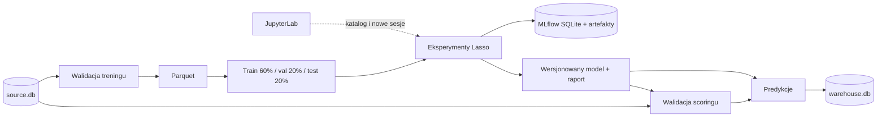
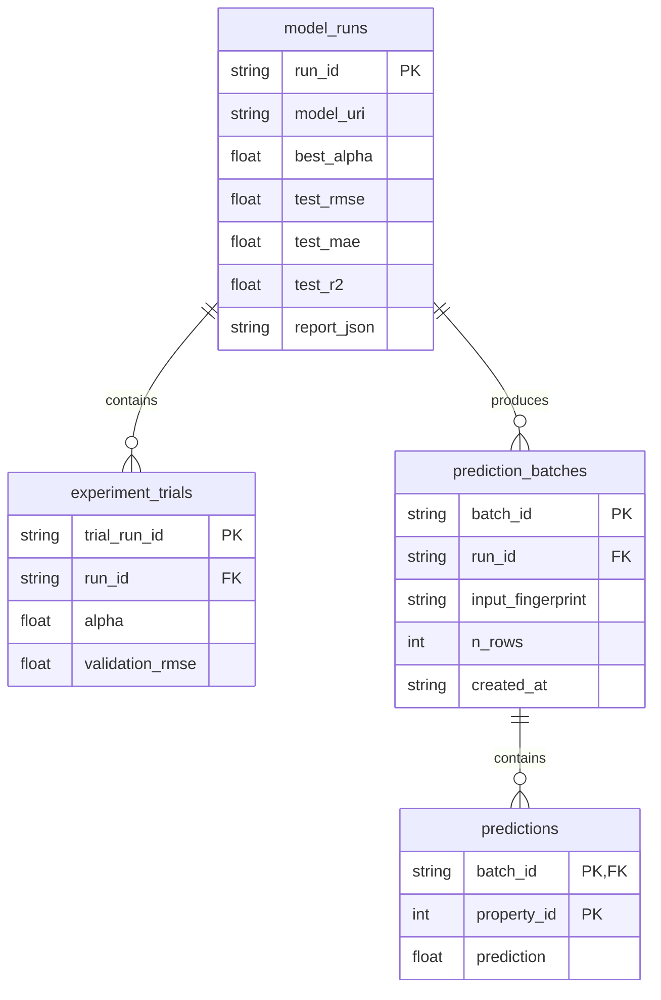

# Architektura projektu

## Podział odpowiedzialności

Kedro odpowiada za graf zależności, konfigurację, katalog danych i wykonanie node’ów. JupyterLab służy do eksploracji i uruchamiania tego samego kodu. MLflow śledzi eksperymenty i przechowuje model do odtworzenia poza Kedro. Kedro-Viz jedynie wizualizuje pipeline; żaden krok obliczeniowy nie wymaga uruchomionego UI.



| Plik lub katalog | Odpowiedzialność |
| --- | --- |
| `src/kedro_lasso/domain.py` | Kontrakty danych, konstrukcja sklearn Pipeline, metryki |
| `training.py` | Podział danych, eksperymenty, wybór i zapis modelu do MLflow |
| `scoring.py` | Predykcja i budowa partii wynikowej |
| `datasets.py` | Adapter wynikowej bazy SQL; schemat i transakcja |
| `pipelines/` | Deklaracje node’ów i ich wejść/wyjść |
| `pipeline_registry.py` | Składanie pipeline’ów `prepare`, `training`, `scoring`, domyślnego |
| `commands.py` | Operacje lokalne: seed, podgląd wyników, serwisy, supervisor |
| `conf/base/` | Wspólne parametry, katalog i połączenia demonstracyjne |
| `conf/local/` | Lokalne nadpisania, ignorowane przez Git |
| `conf/quick/` | Alternatywny zestaw parametrów eksperymentu |
| `notebooks/` | Klient eksploracyjny tego samego projektu |
| `tests/` | Kontrakty, rozłączne podziały, zapis i pełny przebieg |

Nie używamy pluginu `kedro-mlflow`. Jawna integracja MLflow w treningu utrzymuje zależność od niewielkiego API śledzenia eksperymentów. Własny adapter SQL jest potrzebny, aby model, próby, nagłówek partii i wszystkie predykcje trafiły do bazy w jednej transakcji. Źródło i odczyt wyników korzystają ze standardowego `pandas.SQLQueryDataset`.

## Dane i magazyny

Domyślny katalog roboczy to `data/`; `KEDRO_DEMO_DATA_DIR` pozwala wskazać inny katalog bezwzględny.

| Ścieżka | Zawartość |
| --- | --- |
| `source/source.db` | Tabele `training_properties` i `scoring_properties` |
| `warehouse/warehouse.db` | Modele, próby, partie i predykcje |
| `mlflow/mlflow.db` | Metadane MLflow, eksperymenty, runy i metryki |
| `mlflow/artifacts/` | Modele sklearn, konfiguracja, podziały i raporty MLflow |
| `intermediate/` | Ostatnie zwalidowane dane w Parquet |
| `models/lasso.pkl/<wersja>/` | Model bundle z modelem, schematem cech i raportem |
| `reports/training.json/<wersja>/` | Raport danego wykonania Kedro |

W SQLite MLflow przechowuje metadane; pliki modeli i pozostałe artefakty pozostają na dysku. Są to dwa magazyny z różnymi zadaniami.

Źródło jest deterministycznie generowane (`seed=42`). Ceny zależą liniowo od powierzchni, liczby pokoi, wieku, odległości i wskaźnika energetycznego. `noise_feature` nie ma wpływu na cenę. Dwie cechy mają losowe braki. To dane demonstracyjne; metryki nie opisują rzeczywistego rynku nieruchomości.

`demo seed` nie nadpisuje istniejących tabel. Częściowo istniejące źródło powoduje błąd z instrukcją naprawy; generator nie naprawia go przez kasowanie danych. Do niezależnej demonstracji wskaż nowy `KEDRO_DEMO_DATA_DIR`.

## Trening i brak przecieku informacji

1. Walidacja wybiera jawne cechy, sprawdza typy liczbowe, ID, nieskończoności i target.
2. Powstają rozłączne, odtwarzalne zbiory train/validation/test. Proporcje w konfiguracji odnoszą się do całego wejścia.
3. Dla każdej wartości `alpha` tworzony jest osobny model `SimpleImputer(median) → StandardScaler → Lasso`. Imputer i scaler są dopasowywane tylko do train.
4. Kandydaci są porównywani wyłącznie po walidacyjnym RMSE. Każdy kandydat to podrzędny run MLflow.
5. Wybrane `alpha` służy do ponownego dopasowania na train+validation. Ten końcowy model jest oceniany na teście. Raport zawiera też testowe metryki `DummyRegressor`, jako punkt odniesienia.
6. Nadrzędny run MLflow zawiera model z sygnaturą, przykładem wejścia i wersjami zależności, raport, konfigurację, fingerprinty i ID rekordów w podziałach.

Kolejne świadome zmiany po obejrzeniu testowych wyników mogą prowadzić do dostrajania do testu. Przed oceną rzeczywistej jakości potrzebny jest nowy zbiór końcowy lub zewnętrzna walidacja. Projekt demonstruje pojedynczy podział; nie implementuje walidacji krzyżowej ani monitorowania dryfu.

Lokalny bundle Kedro i model MLflow korzystają z serializacji Python. Wczytuj tylko własne lub zaufane artefakty. Wersjonowanie Kedro zachowuje kolejne modele; pipeline `scoring` domyślnie ładuje najnowszą wersję. Konkretną wersję można przypiąć przez standardową konfigurację `load_versions` Kedro zamiast polegać na najnowszym katalogu.

## Baza wynikowa



`WarehouseDataset` używa jawnych typów, kluczy głównych i obcych. Przy SQLite włącza foreign keys, limit oczekiwania na blokadę oraz jawne transakcje. Utworzenie schematu i zapis danych podlegają transakcji. Ponowny zapis tego samego `batch_id` zastępuje tę partię atomowo; uszkodzony zapis wycofuje się w całości. Nowe uruchomienie scoringu generuje nowe `batch_id`, zachowując poprzednie partie.

Idempotencja dotyczy ponownego zapisu tej samej przygotowanej partii, a nie ponownego uruchomienia pipeline’u. Model i jego próby zapisują się przy pierwszym eksporcie predykcji. Pipeline `training` zapisuje model i raport, lecz sam nie tworzy wpisu w warehouse.

MLflow, pliki Kedro i wynikowy SQL nie uczestniczą we wspólnej transakcji rozproszonej. Jeżeli eksport SQL zawiedzie po treningu, run i model pozostają zapisane; po usunięciu przyczyny można wykonać `kedro run --pipeline scoring`. Stan MLflow `FINISHED` oznacza zakończenie treningu, nie gwarantuje zakończenia eksportu SQL.

## JupyterLab i wykonanie wsadowe

`demo lab` wywołuje `kedro jupyter lab`, ustawia kernel projektu i katalogi robocze w `.runtime/`. Notebook uzyskuje dostęp do `catalog`, `context`, `session` i `pipelines`. Odczyt przez `catalog.load()` korzysta z tych samych połączeń co pipeline.

Każde wykonanie pipeline’u w notebooku dostaje nowy `KedroSession`. `runtime_params` nadpisują parametry tylko tej sesji. `%reload_kedro` odświeża kontekst po zmianie kodu, konfiguracji lub zapisaniu nowego modelu. Logikę zaakceptowaną po eksperymencie przenosi się do `src/`; trwałe ustawienia do YAML. Zadanie cykliczne lub CI uruchamia potem `kedro run` bez notebooka i bez JupyterLab.

Wersja notebooka w repozytorium jest bez wyników wykonania. `scripts/verify_notebook.py` wykonuje wszystkie komórki na osobnych bazach i zapisuje egzemplarz z wynikami w `.runtime/executed_notebook.ipynb`.

## Zmiany konfiguracji i rozszerzanie

### Inne parametry

```powershell
uv run kedro run --env quick --pipeline training
uv run kedro run --params split.random_state=123
```

W Pythonie, po `bootstrap_project(PROJECT_ROOT)`:

```python
with KedroSession.create(
    project_path=PROJECT_ROOT,
    runtime_params={"model": {"alphas": [0.1, 1.0, 100.0]}},
) as session:
    session.run(pipeline_name="training")
```

Parametry są scalane rekurencyjnie (`merge_strategy.parameters: soft`), więc środowisko i `runtime_params` mogą nadpisywać pojedyncze pola bez usuwania pozostałych ustawień grupy.

Zmiana cech w `parameters.yml` dotyczy nowego treningu. Niezależny scoring używa schematu zapisanego z modelem, również gdy bieżące parametry treningowe zostały zmienione.

### Inne bazy

Plik `conf/local/credentials.yml` może zastąpić połączenia:

```yaml
source_db:
  con: ${oc.env:SOURCE_DATABASE_URI}
warehouse_db:
  con: ${oc.env:WAREHOUSE_DATABASE_URI}
```

Skonfiguruj zmienne w środowisku procesu oraz doinstaluj sterownik dla docelowej bazy przez `uv add`. Dostosuj SQL wejściowy w `catalog.yml`, zachowując kontrakt cech i integer ID. Generator `demo seed` jest przeznaczony wyłącznie do demonstracyjnego źródła; przy rzeczywistych danych uruchamiaj pipeline bez seeda.

Adapter warehouse korzysta z SQLAlchemy Core. Lokalnie testowana jest implementacja SQLite; zmiana na PostgreSQL wymaga testu integracyjnego ze sterownikiem, docelowym serwerem i jego uprawnieniami. Równoległy eksport wielu procesów wymaga obsługi konfliktów/upsertów i retry dostosowanych do bazy. `create_all` zakłada schemat startowy; zmiany istniejących tabel wymagają migracji, których projekt nie implementuje.

### Inny model lub serwer śledzenia

Model jest konstruowany w `domain.make_model()`. Przy zmianie rodziny estymatora zmień też parametry i zapis metadanych w `training.py`. `score_batch()` przyjmuje zapisany obiekt z metodą `predict()`.

`MLFLOW_TRACKING_URI` może wskazywać HTTP zamiast bezpośredniego SQLite. Przy HTTP lokalizacja artefaktów pochodzi z serwera MLflow; klient nie narzuca lokalnego `file://`. Compose używa właśnie tego wariantu, z proxy artefaktów i wspólnym wolumenem po stronie serwera. `demo mlflow` zawsze uruchamia własny, lokalny serwer na demonstracyjnej bazie; przy zewnętrznym serwerze wystarczą komendy treningu i `demo lab`.

Nie przenoś istniejącego pliku bazy MLflow bez jego artefaktów: metadane lokalnych eksperymentów zawierają bezwzględne URI plików. Nowy katalog roboczy powinien mieć nową bazę i własny katalog artefaktów.

## Granice demonstratora

To lokalny stack z modularnym kodem, walidacją, wersjonowaniem modelu, śledzeniem eksperymentów, historią i transakcyjnym eksportem. Nie ma wdrożenia modelu jako API, automatycznego harmonogramu, rejestru promocji modeli, monitoringu dryfu, migracji baz, retencji, kopii zapasowych ani kontroli dostępu dla współdzielonej infrastruktury.

Uruchamiaj pojedynczy pipeline zapisujący naraz. Pliki Parquet mają stałe ścieżki, a SQLite ma ograniczenia współbieżnych zapisów. JupyterLab i MLflow powinny współpracować z jednym aktywnym treningiem. Do pracy zespołowej kolejne kroki to PostgreSQL dla metadanych i warehouse, obiektowy magazyn artefaktów, wydzielony serwer MLflow, uwierzytelnianie i orkiestrator uruchamiający niezmienny obraz. To propozycje rozwoju, nie już wdrożone funkcje.

## Źródła dokumentacji

- [Kedro i Jupyter](https://docs.kedro.org/en/stable/integrations-and-plugins/notebooks_and_ipython/kedro_and_notebooks/)
- [SQLQueryDataset](https://docs.kedro.org/projects/kedro-datasets/en/stable/api/kedro_datasets/pandas.SQLQueryDataset/)
- [MLflow: backend stores](https://mlflow.org/docs/latest/tracking/backend-stores/)
- [MLflow: artifact store](https://www.mlflow.org/docs/latest/self-hosting/architecture/artifact-store/)
- [Kedro-Viz](https://docs.kedro.org/projects/kedro-viz/en/stable/)
